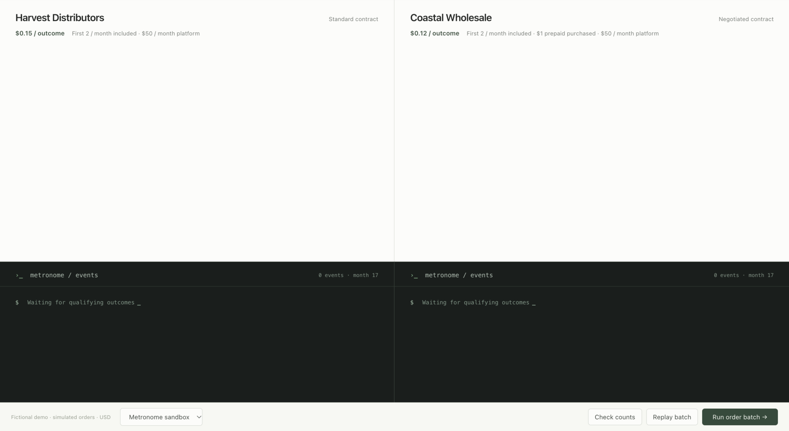
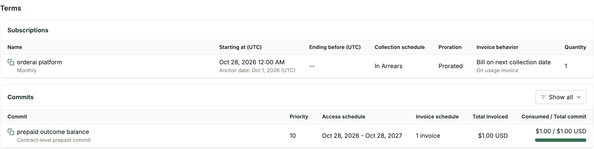
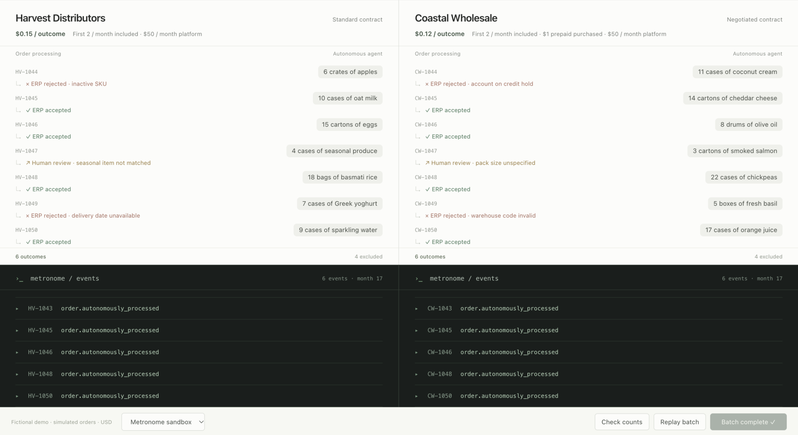
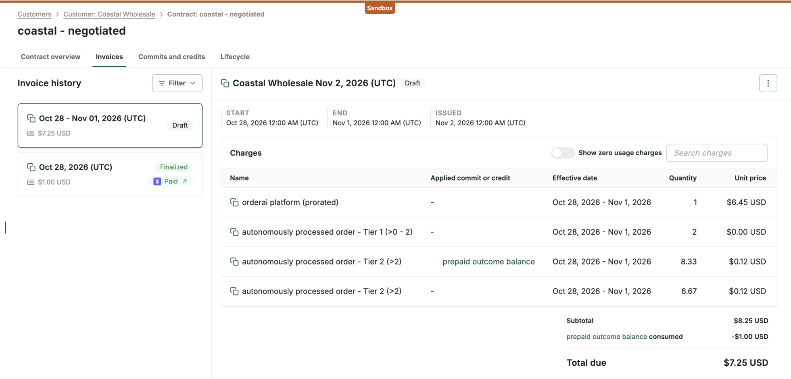

# OrderAI: the same outcomes, different bills

Outcome-based billing charges for an agreed result, such as a successfully processed order, rather than each attempt or API call. For AI services that complete work autonomously, this connects the bill to work the customer actually receives. It depends on a clear, measurable definition of success.

This demo uses **OrderAI**, a fictional AI order-processing platform, and two fictional customers: **Harvest Distributors** and **Coastal Wholesale**. Both receive the same number of successful outcomes, but their contracts produce different charges. It shows how outcome metering works alongside negotiated rates, included allowances and prepaid balances.

## Demo flow

### 1. Local UI — introduce the business case

Click **Replay batch**. Start with four empty quadrants: customer orders above, billing events below.

> “We charge when an order is accepted by the ERP without human intervention. As the business grows, customers negotiate different rates and prepaid agreements. Counting outcomes is only the first part; contracts determine what those outcomes cost.”

The application defines success and sends qualifying events. Metronome counts and prices them; it doesn't judge the AI's work.



### 2. Metronome — show the contracts

Open **https://app.metronome.com/** and walk through the prepared setup:

1. **Billable metric:** COUNT of `order.autonomously_processed`.
2. **Harvest → contract → rate card:** platform subscription, included allowance and outcome tiers.
3. **Coastal → contract:** outcome pricing override, then the prepaid commitment.

All demo prices are **USD**:

| Term | Harvest | Coastal |
| --- | --- | --- |
| Monthly platform, in arrears | $50 | $50 |
| Included outcomes per month | First 2 | First 2 |
| Subsequent outcomes | $0.15 each | 20% off standard ($0.12 each) |
| Outcome-only prepaid balance | None | $1 purchased upfront |

Show Coastal's **20% discount through 28 October 2027**, then the commitment's **eligible product, access dates and remaining balance**. Earlier tests may already have consumed the credit.

> “The event doesn't contain a price. The customer's contract determines the charge.”



### 3. Local UI — run the orders

Select **Metronome sandbox**, click **Replay batch**, then **Run order batch**.

Each customer processes ten different orders, with matching results per line: **six successes, two human reviews and two ERP rejections**. Only successes emit billing events. Expand a terminal row to inspect its payload and customer-specific order ID.

**Offline rehearsal** runs the same sequence without sending events. Order processing itself is simulated in both modes.



### 4. Metronome — compare usage and draft invoices

Open both customers' usage and current draft invoices. Allow time for processing, then refresh.

- Compare outcome counts for the same period; monthly totals include earlier tests.
- Compare the outcome rates after the included allowance: **standard $0.15 versus Coastal's 20% discount ($0.12)**.
- Show prepaid consumption on Coastal, and overage once the balance is exhausted.
- Compare platform fees separately: Coastal started partway through October, so that month's platform fee is prorated.

> “The outcome counts are comparable. The charges differ because the agreements differ.”

Use the draft calculation now; final billing follows the billing schedule. A draft is not evidence of payment.



This sandbox snapshot includes earlier test outcomes; totals change as more events arrive.

## Run locally

Requires **Node.js 22+**. Clone the repository; no dependencies to install.

```sh
npm start
```

Open **http://localhost:3000**. It starts in Offline rehearsal. If that port is occupied, use `PORT=3001 npm start` and http://localhost:3001.

## Connect the sandbox

1. Request Metronome login, a sandbox API key and the prepared customer/contract IDs from **[jills@stripe.com](mailto:jills@stripe.com)**.
2. Copy `.env.example` to `.env`. Set `METRONOME_API_KEY` and `METRONOME_SANDBOX_CONFIRMED=true`.
3. Create the customer mappings, unless they already exist:

   ```sh
   mkdir -p .data
   cp config/customer-target.example.json .data/harvest-target.json
   cp config/customer-target.example.json .data/coastal-target.json
   ```

   Fill each file's `customerId`, `contractId` and shared `metricId`. Expected customer names: **Harvest Distributors** and **Coastal Wholesale**.

4. Restart `npm start`. Select **Metronome sandbox** and use **Check counts** before running.
